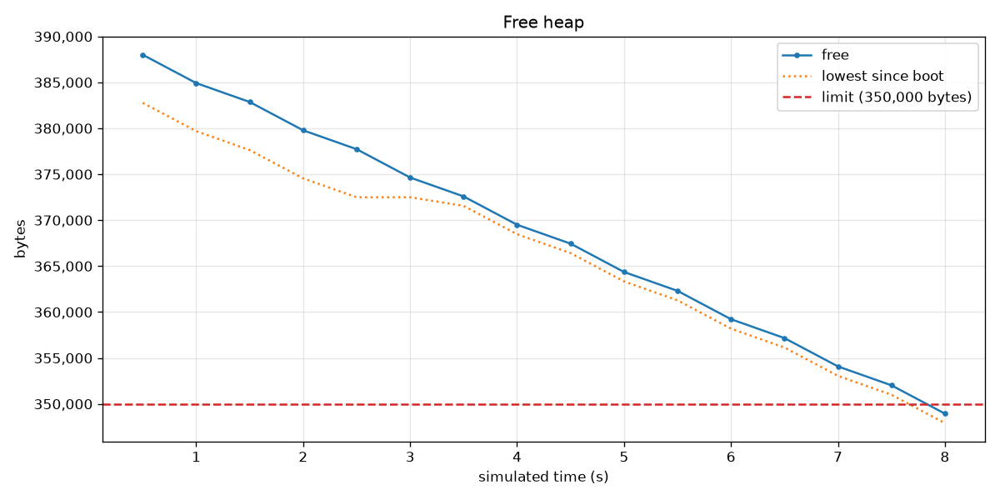

# ESP32-S3 heap leak demo

A small ESP-IDF app with a memory leak in it, and a [Wokwi](https://wokwi.com) CI setup that catches the leak in seconds.

Leaks like this one rarely show up in a quick test: the device works fine, then runs out of memory after a day in the field. Wokwi fast-forwards through lots of use in a short CI run and keeps an eye on the heap while it does. You don't need any logging code for that: the Wokwi CLI reads ESP-IDF's heap counters right from the simulated chip.

## What's in here

The firmware handles "requests": a press of the button on GPIO4, or a line on the serial console. Every 4th request is a cache hit, and on that path the handler forgets to free its 1 KB response buffer. That works out to about 257 bytes lost per request.

## Build

You'll need ESP-IDF 6.0 or newer:

```sh
idf.py build
```

## Catch the leak

`scenarios/leak.test.yaml` presses the button 200 times, then waits for the firmware to say `handled 200 requests`. Run it with heap monitoring on:

```sh
export WOKWI_CLI_TOKEN=...   # get one at https://wokwi.com/dashboard/ci
wokwi-cli . --scenario scenarios/leak.test.yaml --timeout 60000 \
  --heap-interval 500 --heap-min-free 350000 --heap-csv heap.csv
```

The CLI checks the heap every 500 ms of simulated time and fails the run once less than 350,000 bytes are free:

```
[heap esp] 0.500s free=388008 min=382776
[heap esp] 1.000s free=384924 min=379692
...
[heap esp] 8.000s free=348944 min=347916

Error: free heap 348944 dropped below 350000 bytes at 8.000s
Heap: 16 samples, free 388008 -> 348944, lowest 347916, 5209 bytes/s lost
TEST FAILED.
```

Every sample also lands in `heap.csv` (`part,time_s,free,min_free`). Want a picture? This draws it into `heap.png`:

```sh
pip install matplotlib
python3 scripts/plot-heap.py heap.csv --limit 350000
```

(Or skip the install with [uv](https://docs.astral.sh/uv/): `uv run scripts/plot-heap.py heap.csv --limit 350000`.)



Want a longer run? Generate a scenario with more presses (any multiple of 50):

```sh
scripts/gen-scenario.py 1000 > scenarios/leak.test.yaml
```

You can also open the project in Wokwi for VS Code and press the button yourself.

## Fixing it

Have a look at `handle_request()` in `main/main.c`: on a cache hit, it returns without freeing `response`. Add `free(response);` before that `return` (or allocate `response` after the cache check), rebuild, and the test passes with a flat heap.

## On a real board

Want to see the leak on an actual ESP32-S3 DevKitC-1? Turn on *Heap leak demo -> Log the heap from the firmware* (`CONFIG_DEMO_HEAP_LOG`) in `idf.py menuconfig`. The firmware then logs the free heap every 500 ms, and prints `HEAP LOW` once it has lost 32 KB since boot. Flash it with `idf.py flash monitor` over the UART port, then send requests by pressing Enter in the monitor, or wire a button between GPIO4 and GND.

## GitHub Actions

`.github/workflows/heap.yml` builds the firmware, runs the test on every push, and uploads `heap.csv` and the plot as an artifact.

Pushes to the default branch also show the plot right in the job summary. Job summaries only display hosted images, so the workflow publishes the plot on GitHub Pages. To turn that on in your copy of the repo, set *Settings -> Pages -> Source* to *GitHub Actions*.
